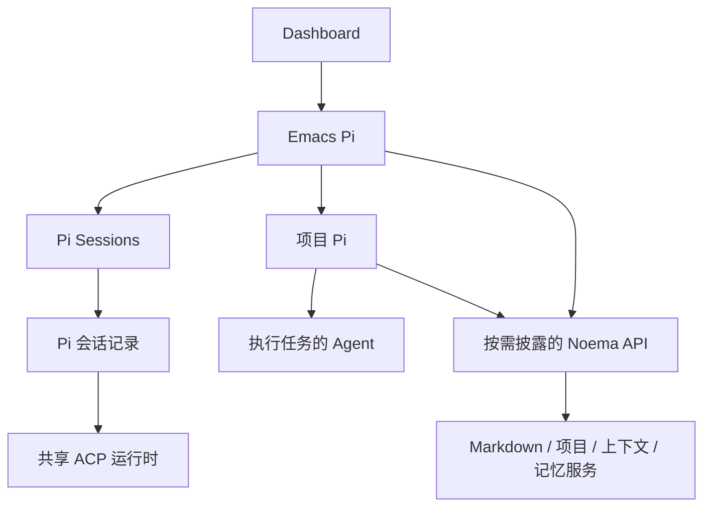

# Pi 会话与项目助手

## 范围

Pi 是 Emacs 的常驻助手，并在项目中首次调用时创建该项目的助手。本文约定 Pi 的独立
会话管理，以及它与首页、buffer、执行 Agent、Markdown 和 Noema 服务的边界。

## 模型

| 对象 | 负责什么 | 不代替什么 |
| --- | --- | --- |
| Pi 作用域 | Emacs 全局，或一个 target 上的项目根目录；管理关系属于作用域 | 原生对话身份 |
| Pi Session | 一个真实原生对话的身份、名称、作用域、创建与归档记录 | 进程或 buffer |
| 活跃指针 | 该作用域下一次继续哪一个 Pi Session | 整段 transcript |
| ACP client / buffer | 当前连接、队列、权限、草稿和显示 | 持久 Session 身份 |
| 执行 Agent | 接受明确任务与上下文，返回结果 | 项目 Pi 的管理对话 |

Emacs Pi 负责编辑器操作、跨项目路由和找到项目 Pi。项目 Pi 负责项目上下文、
任务分工、prompt 文档和交接。执行 Agent 只获得该任务需要的材料和写入范围。
项目 Pi 的管理关系指向 Emacs 作用域；主 Pi 换对话不会销毁项目 Pi 的历史。

## 契约

- **C1 独立会话域。** Pi 自己维护原生对话引用与活跃指针，保留同一项目的历史
  对话。Pi 不自动 `session:promote`、绑定 Research 会话名或创建 Workstream。
  Noema Research 的 Session、Run、权限与证据仍由原服务管理。
- **C2 复用运行时。** Pi 使用共享 ACP 连接、原生历史、队列与权限回应。
  Pi 的独立会话管理不再实现一套进程或 transcript。恢复使用真实 native ID；
  新对话与恢复分开，失败不能悄悄换成空白对话。刚初始化的空对话只有运行时
  身份；提供方确认保存历史后才成为持久记录，不为制造历史发送虚假 prompt。
- **C3 初始化没有任务副作用。** 主程序启动时进入 Dashboard，Pi 在后台初始化，
  不提交模型 prompt、不切换窗口。进入项目不创建 Pi；项目中首次调用才建立
  该项目独立的 buffer 与 native Session，后续调用复用。切换项目不结束旧会话。
  CLI 和 stdio MCP 入口按文件真实路径识别启动，兼容 Emacs 配置目录的符号链接。
- **C4 视图可发现。** Ibuffer 的 Pi 分组列出真实 Pi buffer；Pi Sessions 查看
  当前与历史对话，普通 Agent Manager 只管理执行会话。后台不显示窗口不等于隐藏
  buffer。Dashboard 直接打开主 Pi；Pi Sessions 保留独立历史入口。
- **C5 生命周期分开。** 关闭聊天视图不停止 client；停止当前回合、结束 Pi、
  换新对话、归档历史分别处理。结束项目 Pi 不结束该项目的执行 Agent。
  新 client 的管理登记失败或取消时清理本次创建的 buffer 与 client，允许重新启动。
- **C6 逐步披露。** 首次只提供小型 API 入口。知道名字和参数就直接调用，参数不明才查看
  一个接口，名字不明才搜索；这是可用的层次，不是必走的步骤。本轮只发送任务、项目与
  位置引用。Skill 正文和参考章节按需读取。搜索匹配注册名字、用途和别名，先排名字命中；
  结果仍只给名字，空查询只给各领域的数量。接口说明列出字段时不带实现，`source:true`
  才带；没有字段说明的接口以实现为契约，照常带上。
  编辑器操作由 `noema-editor-interaction` 披露：Pi 使用语义 API，有 shell 的 Agent
  可使用 `emacsopen -o`。API 不依赖 Pi 的 Session 管理动作或 Elisp 执行能力。
  Agent 请求打开文件默认在其他窗格，复用已有文件视图；显式位置优先。
  返回实际窗口结果后才报告已打开，不能把通知已排队当作已显示。
- **C7 文档复用。** 申请 prompt 文档由 Skill 指导项目 Pi 创建、打开普通 Noema
  Markdown。用户保存并发送后才执行；改写用版本化提案 API，由人审阅。
- **C8 状态可核对。** native ID 与归档事实持久化；运行、忙碌、等待权限、可见与
  连接失败从实际 ACP 状态派生。恢复历史不假装附着到其他进程的活动执行。
  重连优先继续当前物理会话的 native ID 或待恢复 ID，不被较早的持久活跃指针替换。
- **C9 按项目召回。** `M-x pi`、`C-c A P` 在项目中召回该项目 Pi，无项目时召回
  主 Pi；带前缀强制主 Pi。Dashboard 的 `pi` 与 `noema-pi-emacs-open` 是主 Pi
  的明确入口。在对应聊天窗口再次调用时收起视图并返回来源。
  主 Pi、项目 Pi、执行 Agent 分别保留真实 buffer 和会话身份。
- **C10 当前上下文是查询。** `emacs:pi` 的 `context` 从当前选中窗口解析编辑来源，
  返回文件、target、项目、位置和选区的引用，不复制正文、不保存、不启动会话。
  Noema 页面只报告已知文件身份，不用占位 buffer 伪造页面的行号、选区或修改状态。
  主 Pi 不把自己的启动目录当成用户当前项目。
  没有可用编辑来源时返回 `sourceAvailable:false`，目录与项目为空，不回退到 Pi 的 home。
  `sourceAvailable`、`pageOwned`、`modified` 经 gateway 保持 JSON 布尔值，不返回符号名字符串。
- **C11 调度复用公共 Agent。** Pi 通过 `emacs:agent` 查询、创建、发送、读取结果
  或停止真实会话；没有另一份 Agent 注册表、队列或执行状态。变更和读取必须携带
  buffer 与 native ID，防止把旧指令发送到同名新会话。查询不打开 UI；创建不提交
  任务；发送默认后台受理，只有显式 focus/show 才显示。受理、排队和完成分别报告。
  正常完成后继续原生排队任务；停止、失败或拒绝后保留挂起任务，等待显式恢复。
- **C12 Idle 预热。** 启动只登记一次主 Pi 的 idle 工作，项目切换不安排启动。
  明确打开或发送才创建或复用项目 Pi；关闭自动模式或退出取消
  待执行工作。已有对话不随项目切换结束，主 Pi 不按普通执行 Agent 回收。
  主 Pi 与项目 Pi 的同作用域启动都防止重入；失败或取消释放启动占用，不阻止重试。
- **C13 异步工作有归属。** 每个物理 Pi 的历史确认最多一个在途请求，合并同一
  回合的重复观察；回调检查 client 代际、native ID 和当前作用域归属。工具事件
  合并为一个有上限等待的协调查询，同一 client 只允许一个在途协调请求，只有派发时
  才检查 Research 项目。结束 client、关闭 buffer 或改变其 major mode 都会
  释放定时器、订阅和过期请求的写入资格，不让旧结果改变新会话的活跃指针。
- **C14 元数据按事实更新。** 使用文件签名校验的有界缓存，不轮询文件。外部替换
  和损坏在下次查询时可见；写入前编辑副本，失败不污染已读事实，相同值不重写。
  同一 native 回合重复通知不反复解析与保存整份索引。
- **C15 列表按需刷新。** Pi Sessions 合并突发状态事件，只有可见时才安排单次刷新；
  隐藏、关闭和退出取消待执行刷新。列表静止时没有周期刷新或元数据读写。
- **C16 回合通知一致。** 原生输入和 API 结构化发送完成后都经过共享回合通知，
  让历史确认与文件刷新收到同一事实；陈旧回调不报告当前会话完成。
- **C17 管理按作用域分开。** 主 Pi 属于全局 `emacs`，项目 Pi 属于对应项目。
  Pi 的 tab、切换、管理入口、批量关闭和关闭回退不混入执行 Agent；执行 Agent
  的项目池与管理器也不接管 Pi。Pi 聊天的管理按钮和 `C-c C-l` 打开本作用域的
  Pi Sessions。项目会话列表跟随明确的项目切换，主 Pi 列表保持全局；带前缀
  打开 Pi Sessions 才查看所有作用域。空项目列表的新建仍属于该项目。
  切换项目时旧列表行立即失效，合并刷新前的操作也不能访问或归档前一项目的对话。
  `/new`／`C-c A n` 在 Pi 中新建本作用域对话，在执行会话中创建执行 Agent。
  分类依据是管理角色来源，手动启动的 Pi 提供方仍是普通执行会话。共用 ACP
  物理注册表与生命周期，不增加另一套进程管理。同名执行会话不会使 Pi 退役，
  命名查询与替换也遵守管理作用域。
- **C18 Emacs 私有配置。** 主 Pi 与项目 Pi 使用 Emacs 固定版本的本地运行时，不依赖系统
  Pi 安装或 `~/.pi/agent`。手动启动的 Pi 提供方是普通执行会话（C17），与其他提供方一样
  从 target 的 PATH 解析 `pi-acp` 并使用它自己的配置，因为管理配置关闭了执行工具。可版本化的默认模型池、提示词、扩展和 Skill 属于源码；
  本机覆盖、模型配置与认证属于忽略的 `etc/noema/pi/`，原生会话、索引和缓存属于
  `var/noema/pi/`。原生目录以符号链接组合这些文件，不保存第二份配置。
  Config 面板与 Pi 使用同一设置；默认 `openai-codex/gpt-5.6-luna`、推理 `medium`，
  保留已有后端池。新建与重连通过原生 config options 应用配置的推理级别。
  Codex 登录通过只读引用复用，不复制 token，也不改写独立 Pi 的用户目录。
  Pi 与 Hy Memory 的 Node client 复用系统 CA bundle；显式的
  `NODE_EXTRA_CA_CERTS` 优先。重连保留环境，不关闭证书校验。
- **C19 Skill 自动披露。** Skill 与 pack 由既有 Skill Manager 统一管理，Pi 消费
  其中有效定义标记 `agent_catalog: true` 的操作包，没有独立的 Skill 名单或管理配置。
  标记遵守项目覆盖与 patch，显式禁用优先；`requestedPacks` 可替换默认目录包。
  这个标记只选择 Agent 的自动目录，不为研究 Run 全局启用 pack。项目 Skill、禁用、
  依赖和 patch 复用 Noema 能力解析器；只自动披露 pack 的成员与 preamble，以及 Skill 的
  名称和用途，写成每回合都带的短文本，来源路径和正文按需读取一个有效 Skill。描述和 preamble 的长度由测试卡住。目录只含操作包成员及其依赖、项目
  选择（含项目 `extends`）和明确请求的 Skill；仅全局启用的领域 Skill、pack 及其
  独有依赖留给 Run，仍可按 ID 读取。诊断也只来自目录选择和依赖。
  没有原生 read 工具时也能通过 Noema API 使用它们。
  自动目录包含 Emacs/Noema 操作、Agent/ACP、上下文、Hy Memory、流程与交接、
  文档/项目 Skill 管理、项目缓存与共享资源和 Noema Markdown 语法；不把整库正文注入每个回合。
  这些指导复用现有运行能力，不创建另一套记忆、流程或文档管理器。
- **C20 Pi 工具自动允许。** 主 Pi 与项目 Pi 使用 agent-shell 的内置自动允许
  responder，默认 `noema-pi-permission-policy=allow`。Config 面板可切回 `ask`；
  更新作用于现有 Pi 与当前待处理请求，重连后仍按同一设置执行。
  权限响应保留实际 client 和 request 身份，不向已结束或被替换的请求回复。
- **C21 项目视图有归属。** Ibuffer 的 Agent 与 Pi 使用互斥分类。项目 Pi 的
  buffer、native Session 与历史属于项目，不把主 Pi 或别的项目 Pi 当作它。
  项目切换撤下前一项目的 Pi 视图；调用当前项目 Pi 才显示它，不替别的项目
  创建进程。各项目的会话继续保留，由同一显示 owner 管理各自返回位置。
- **C22 Pi 是可直接沟通的 Agent。** 项目中的普通 ACP 会话从入口提示（C51）得知 Pi 存在、
  自己的 `buffer` 与 `nativeSessionId`，方法在 `noema-pi` Skill。`emacs:pi` `send` 带 `from`
  时，Emacs 先按身份核对这个会话，再把它的 Agent、buffer、native ID、项目根和可直接使用的
  回复调用写成消息头；核对不过拒绝发送，头不由调用方拼写。Pi 照这个调用回复，不用查接口，
  忙时排队，所以调用方可以结束回合等待，不轮询。主动查看用 `status` 取身份后 `emacs:agent` `read`。
  Pi 发给 Agent 的消息由 MCP 入口在代码里加 `[From Pi, not the person]`，模型省略不了；入口靠
  Emacs 配给它的 `NOEMA_CALLER` 知道调用者。消息头和回复都表明来自 Agent，不带人的批准；Pi 只回复
  一次，不回应确认，避免互相续杯。

- **C23 披露与建议，按复杂度取用。** 提示词、Skill、pack 和 API 说明披露有什么、何时值得用，
  由 Agent 按任务大小判断；只有安全与归属是硬规则（人的审批、审阅卡片、版本与冲突处理、
  不碰 `.agent/` 内部）。小事走最少的调用：Noema 页面的短选区（不超过
  `noema-md-bridge--inline-selection-limit`）随请求带上原文，这是引用规则的唯一例外，
  `agent:document:propose` 可不带 `baseVersion`，此时每处 `oldText` 在其位置上精确相符就是
  校验，一次调用即可产生审阅卡片；保留 `document:read` 给看不到原文、越出选区或报告
  不符的情况。入口提示、`help`、MCP 说明都给出常用调用的完整形状，省掉 describe。
  每回合或每会话都带的文本有预算：`SYSTEM.md`、pack preamble、Skill 描述与正文、入口提示、
  审阅引导的长度由测试卡住。测试：`C23 *`、`*-c23-*`、`noema-agent-entry-c51-offers-*`。
- **C24 API 失败说实话。** 客户端只把 `ESRCH` 当成进程不存在；沙盒中查询存活得到的
  `EPERM` 不代表 host 已停。请求根本没发出（找不到 host、连接被沙盒拦截或被拒）时明说
  没有发送，并指出真正的原因；只有请求可能已到达才说结果未知、改动前先读状态。
  Agent 据此判断要不要叫人重启，不把沙盒当作 host 故障。测试：`C24 *`。
## 工作流程

1. **打开主程序：** 首页选择 Dashboard → 后台恢复 Emacs Pi → Ibuffer 出现 Pi。
   未配置或初始化失败时保留首页，并通过现有诊断与 Pi Sessions 显示事实。
2. **在项目里调用 Pi：** 根据 target 与项目根定位作用域 → 恢复该项目活跃 Pi；
   首次使用时创建独立 buffer 和原生对话 → 登记管理关系。不依赖 `.noema`。
3. **准备任务：** 通过项目 Pi 申请 Markdown 文档 → 用户编辑 → 保存后发送给
   选中的执行 Agent。文档、会话、任务产物分别保留自己的身份。
4. **执行和反馈：** API 创建或修订提案 → 页面响应保存通知 → 人审核或评论 →
   同一 Session 按文件位置继续。提交成功与执行完成分别报告。
5. **Agent 之间协作：** Agent 按入口提示用 `emacs:pi` 找 Pi → Pi 按消息头回复到它的会话 → 后续事情
   写成观察项。日常用法见[用 Pi 协作](../guide/pi-collaboration.md)。
6. **长任务接续：** 先按预算检索与选择上下文，再生成可核查的交接；需要新对话
   时保留旧 native ID 和新旧关系，更新活跃指针。原生压缩按实际能力提供。

## 存储与实现

Pi 的 `sessions.json` 保存在自己的状态目录，包含 Session 记录与作用域的活跃
指针，仅保存元数据及原生引用。`assistants.json` 自动导入一次；首次进入一个
没有新记录的项目时也可读取旧 `.agent/pi.json`。来源文件保留。旧 Research
注册表使用 `Pi Sessions` 的 `i` 显式读取；导入不替换已有活跃对话，也不写回
Research。新建和归档后不再被旧索引悄悄重新激活。

Pi 原生 SDK 在首次 assistant 消息前不会保存对话。控制器通过成功恢复或原生
`session/list` 确认持久性，随后才保存活跃指针。未保存的空对话仍在 Ibuffer 和
Pi Sessions 中可见。早期索引中的此类引用保留并标为 `not saved`，不再自动
恢复。未知的导入引用不被静默丢弃；恢复失败保留引用并显示失败，用户可显式
换新对话。通用 Agent 的恢复策略保持自己的约定，Pi 启用严格恢复选项。

Dashboard 的 `pi` 入口打开主 Pi。`M-x noema-pi-sessions` 查看当前 Pi／项目的历史；
`C-u M-x noema-pi-sessions` 查看全部。`RET` 恢复，`n` 新建，`a`
归档，`i` 导入，`g` 刷新。初始化中的真实 buffer 也列出；有连接错误时显示
实际状态，不伪造可用的空白对话。Ibuffer 的 Pi 组同时列出管理视图和真实聊天。

普通 Pi 会话继续复用既有 Hy Memory 召回与写入；项目审核记忆、冻结 RunSpec 与
回执只在其实际服务约束下调用。需要 Workstream 的接口仍需要真实身份。
父子 Pi 不复制整段 transcript，跨会话交接使用实际 Markdown 记录和必要引用。

`noema-pi-router` 管理角色、启动与派发；独立 Session 模块管理记录与会话列表；
`tools/agent/acp` 管理实际 client；Ibuffer 与 Dashboard 由既有 Emacs UI 配置管理。
API 与 Markdown 审阅见 [Noema 交互](../noema/design/interaction-plan.md)。

| 文件 | 归属 |
| --- | --- |
| Emacs `config/pi/runtime/package*.json` | 进 Git 的固定 npm 依赖与 lock；`make pi-setup` 安装 |
| Noema `resources/pi/profile.json`、`SYSTEM.md`、`extensions/` | 进 Git 的默认模型池、提示词与扩展（含观察项的执行者 `watcher.mjs`）；Skill/pack 归既有管理器 |
| Noema `resources/skills/noema-{agent-operations,context-memory,pi,project-docs,project-maintenance,workflow-audit}/` | 与实现一起维护的操作 Skill；其它知识库 Skill 仍在原库 |
| Emacs `etc/noema/pi/config.el` | 私有 Config 面板覆盖，按需生成；默认值仍来自版本化 profile |
| Emacs `etc/noema/pi/{settings,models,auth}.json` | 私有 Pi 配置和认证；原有 `var/` 文件首次部署时迁移，保持引用 |
| Emacs `var/noema/pi/` | 原生会话、索引和缓存；配置、提示词与扩展使用符号链接，Skill 不另建目录 |

修改全局 Pi 配置后，新建或重连使用更新后的配置；现有回合不被自动重启。
自动启动开关会立即取消或安排 idle 工作。Skill 清单在明确发起的回合前按当前
项目重新查询，静止与隐藏期间不轮询。格式遵循
[Agent Skills](https://agentskills.io/specification) 的描述与正文渐进披露。

| 实现入口 | 所有权 |
| --- | --- |
| `site-lisp/noema/lisp/noema-pi-router.el` | 主／项目 Pi、作用域、部署、管理关系和派发 |
| `site-lisp/noema/lisp/noema-pi-sessions.el` | 持久记录、活跃指针、导入、新建、恢复、归档和列表 |
| `lisp/tools/agent/acp.el` | 原生连接、历史查询、严格恢复、队列、权限和物理重启 |
| `lisp/tools/agent/api.el` | 公共 Agent 的语义调用，复用注册表与 ACP，不另存执行状态 |
| `lisp/tools/agent/{selection,context,compose}.el` | 编辑器选区、按 Session 注入和普通文档动作 |
| `server/Features/Agent/api.mjs` | API 名字披露、单接口说明、调用和版本化文档提案 |
| `noema-prompt-document` Skill | 创建／打开普通 Markdown 的操作指导 |

`noema:api:emacs:pi` 支持 `context/list/status/ensure/send/resume/new/archive`，`send` 可带 `from`（C22）。`context`
无需 root；其他作用域操作显式传 companion 或 root。后台发送不改变窗口焦点。`list`
分页返回持久历史，并单独报告实际运行的主／项目 Pi；`resume/archive` 接受 Pi
自己的记录 `sessionId`，与 `nativeSessionId` 区分。`send` 的受理不表示回合完成。
历史使用 `total/nextOffset`，项目子会话使用 `childrenTotal/childrenNextOffset`，
两者均接受同一 offset/limit；历史为空时也能遍历所有项目子会话。

## 已知差距

- **G3** 远程项目 Pi 尚未接入完整 target 身份与 API 路由，当前明确拒绝。
- **G4** 原生压缩与跨对话的自动交接尚未做成 Pi 专属 API。当前按实际原生能力
  或 Skill 指导操作，不把指导宣称为已实现的后台接口。

验证入口：`make research-test` 包含独立 Session、Ibuffer、Dashboard、恢复失败
和原有 Agent 契约。可选 `make pi-live-smoke` 使用已安装的 `pi-acp`，在临时目录
通过原生 SDK 建立明确标识的历史 fixture，验证两个真实 client、精确恢复、复用、
物理重启后的父子关系和窗口保持，不提交模型任务、不改用户历史。API 与文档
写入另经真实 host 的 CAS 和页面通知检查。
同一 target 还运行本地 ACP 测试进程，验证管家入口、来源上下文、真实队列续发、
结果分页、草稿保护和停止挂起；`pi-butler-e2e` 在 GUI 中额外验证多 frame 来源。
`tests/agent-api.test.ts` 还以真实子进程验证符号链接下的 CLI 和 MCP 启动。
`test/pi-idle-tests.el` 覆盖重连身份、初始化失败清理，以及 C12–C16 的合并、缓存失效、
失败写入、晚到结果和资源释放；`pi-project-tabs-tests` 验证项目切换立即撤销旧行操作。
`pi-butler-e2e` 验证真实 client 的重连与失败清理，以及 API 完成后的历史确认、
排队续发与空闲无请求、无索引写入。
`make pi-idle-benchmark` 在隔离的临时索引与 buffer 上统计 JSON 解析、重复观察写入、
突发事件重画和暖会话候选检查次数；不连接模型，不读取用户会话。
